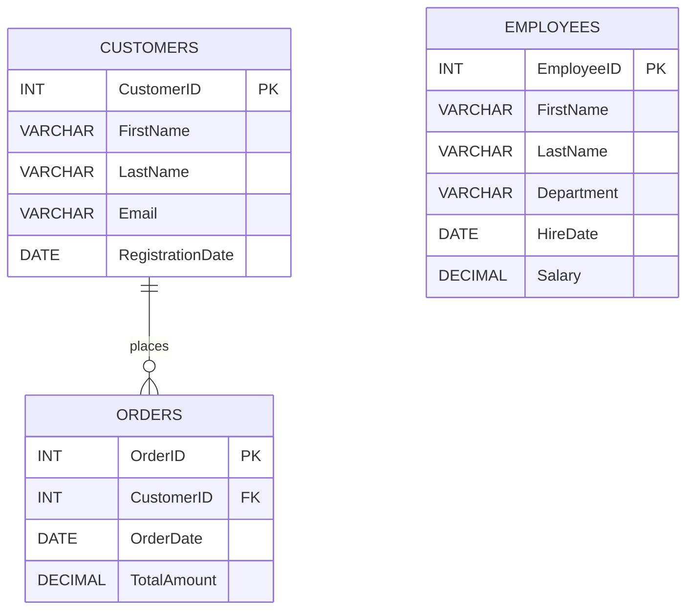
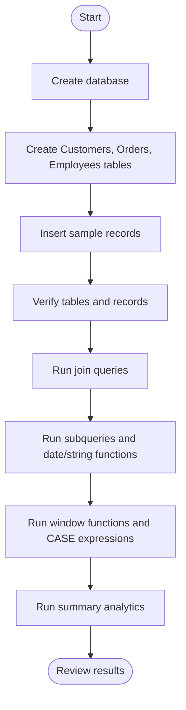
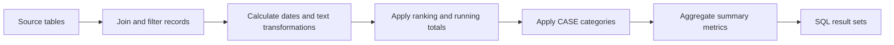

# Data Transformer SQL Project

A professional MySQL project demonstrating relational database design, sample data management, joins, subqueries, date and string functions, window functions, conditional logic, and summary analytics.

## Table of Contents
- [Project Overview](#project-overview)
- [Objectives](#objectives)
- [Database Design](#database-design)
- [Project Workflow](#project-workflow)
- [Queries Covered](#queries-covered)
- [Requirements](#requirements)
- [How to Run](#how-to-run)
- [Expected Results](#expected-results)
- [Project Structure](#project-structure)
- [Notes](#notes)

## Project Overview

The project creates a database named `data_transformer_db` with three related tables:

- **Customers** — customer contact details and registration dates.
- **Orders** — order dates, amounts, and the customer associated with each order.
- **Employees** — employee details, departments, hire dates, and salaries.

Sample records are inserted so the SQL examples return meaningful results. The script then runs verification queries, analytical queries, and summary queries.

## Objectives

- Create tables with primary-key and foreign-key constraints.
- Insert and verify sample records.
- Demonstrate `INNER JOIN`, `LEFT JOIN`, and `RIGHT JOIN`.
- Simulate a full outer join in MySQL using `UNION`.
- Use subqueries, date functions, and string functions.
- Apply window functions for running totals and ranking.
- Categorize orders and employee salaries with `CASE`.
- Generate sales, order-count, and department-level summaries.

## Database Design



**Relationship:** `Orders.CustomerID` references `Customers.CustomerID`. One customer can have zero or more orders. `Employees` is a separate table used for employee and salary analysis.

## Project Workflow



## Queries Covered

| Category | Demonstration |
|---|---|
| Table creation | `CREATE DATABASE`, `CREATE TABLE`, primary keys, foreign key |
| Sample data | `INSERT INTO` for customers, orders, and employees |
| Data verification | `SELECT *` |
| Joins | `INNER JOIN`, `LEFT JOIN`, `RIGHT JOIN`, simulated `FULL OUTER JOIN` |
| Subqueries | Orders above average order value; employees above average salary |
| Date functions | `YEAR()`, `MONTH()`, `DATEDIFF()`, `DATE_FORMAT()` |
| String functions | `CONCAT()`, `REPLACE()`, `UPPER()`, `LOWER()`, `TRIM()` |
| Window functions | Running total with `SUM() OVER`; order ranking with `RANK()` |
| Conditional logic | Order discount and salary categories using `CASE` |
| Summary analytics | `SUM()`, `AVG()`, `COUNT()`, `MAX()`, `GROUP BY` |

### Query Flow



## Requirements

- MySQL 8.0 or a compatible version that supports window functions.
- MySQL Workbench, MySQL Shell, or another MySQL client.
- The supplied SQL script: `data_transformer.sql.sql` (or rename it to `data_transformer.sql` for convenience).

## How to Run

1. Open your MySQL client and connect to your MySQL server.
2. Open the SQL script.
3. Execute the complete script from top to bottom.
4. Confirm that `data_transformer_db` is selected.
5. Review the result sets for table verification, join examples, transformations, rankings, and summary analytics.

Alternatively, run the script from a MySQL command-line client:

```bash
mysql -u your_username -p < data_transformer.sql.sql
```

Replace `your_username` with your MySQL username. Enter your password when prompted.

> **Important:** The script creates the database and tables and inserts sample data. Running it repeatedly without dropping or clearing existing tables may produce “table already exists” or duplicate-primary-key errors. Use a fresh database or reset the project tables before rerunning.

## Expected Results

The script returns multiple result sets, including:

- All sample customers, orders, and employees.
- Customer/order matches from the join queries.
- Customers whose order value is above the average order amount.
- Employees whose salary is above the average salary.
- Order year, month, elapsed days, and formatted date.
- Full customer names and transformed text values.
- A running total and descending order-value ranks.
- Discount labels and salary categories.
- Total sales, average order amount, orders per customer, highest order, and department-level employee statistics.

Exact date-difference values depend on the date when the script is run because `DATEDIFF(CURDATE(), OrderDate)` uses the current date.

## Project Structure

```text
Data-Transformer-SQL/
├── data_transformer.sql.sql
└── README.md


## 🎥 Project Explanation Video

Watch the complete project explanation video:

[▶️ Click Here to Watch the Video](https://drive.google.com/file/d/12rQUMaP3rNft9bHTEkdHWjkMrO34NQ7q/view?usp=sharing)

```

## Notes

- MySQL does **not** directly support `FULL OUTER JOIN`; the script approximates it with a `LEFT JOIN` combined with unmatched rows from a `RIGHT JOIN` using `UNION`.
- The `CASE` expression assigns order discounts as follows: above 1000 → 10% Off; above 500 → 5% Off; otherwise → No Discount.
- Salary categories in this script are: 80000 or more → High; 50000 or more → Medium; otherwise → Low.
- The SQL file contains the query definitions. This README describes the project and workflow; it does not include captured result screenshots.

---

**Project:** Data Transformer SQL  
**Database:** MySQL  
**Focus:** SQL joins, transformations, window functions, and analytical summaries
